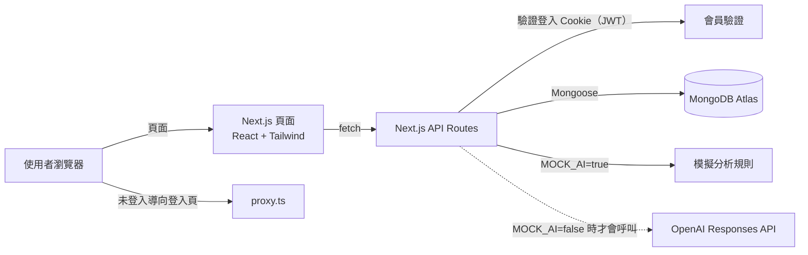

# AI 智慧記帳

> Hahow AI 程式開發課程期末作品：一個使用 Next.js 打造、支援手機瀏覽的個人記帳網站，提供收支管理、分類統計與財務分析報告。

- 🌐 **正式網站**：<https://ai-smart-expense-pi.vercel.app>
- 💻 **GitHub**：<https://github.com/bunnyli32/ai-smart-expense>

> [!NOTE]
> 正式網站的財務分析目前採用 **Mock（模擬）模式**：依會員的真實收支統計，以預設規則產生分析報告，**不會呼叫 OpenAI API，也不會產生任何費用**。頁面上會清楚標示「模擬分析」。詳見 [Mock AI 與正式 AI 模式](#7-mock-ai-與正式-ai-模式)。

---

## 目錄

1. [專案介紹與開發目的](#1-專案介紹與開發目的)
2. [核心功能](#2-核心功能)
3. [使用技術與架構](#3-使用技術與架構)
4. [網站操作流程](#4-網站操作流程)
5. [本機安裝與啟動方式](#5-本機安裝與啟動方式)
6. [環境變數設定](#6-環境變數設定)
7. [Mock AI 與正式 AI 模式](#7-mock-ai-與正式-ai-模式)
8. [正式網站與 GitHub](#8-正式網站與-github)

---

## 1. 專案介紹與開發目的

很多人記帳只停留在「記下來」，卻很少回頭看錢花到哪裡、這個月和上個月有什麼不同。**AI 智慧記帳**希望把記帳、統計與分析放在同一個地方：

- 用最少的步驟記下每一筆收入與支出。
- 自動整理成每月摘要、分類統計與近 6 個月趨勢，一眼看出消費結構。
- 根據自己的真實記帳資料產生財務分析報告，提供具體的改善建議與下個月的預算規劃。

這個專案也是課程的期末作品，目標是實際練習一個完整網站需要的各個環節：前端介面、API、資料庫、會員驗證、AI 串接、版本控制與雲端部署。

## 2. 核心功能

### 會員註冊、登入與登出
- 使用暱稱、Email、密碼註冊；密碼長度 8～72 個字元。
- 密碼以 **bcrypt** 雜湊後才存入資料庫，不保存明碼。
- 登入後以 **JWT** 存放在 httpOnly Cookie 中，有效期限 7 天。
- 會員專區（儀表板、收支管理、分類統計、財務分析）未登入時會自動導向登入頁。
- **資料隔離**：所有 API 都以登入憑證中的會員身分查詢資料，每位會員只能存取自己的紀錄。

### 收支管理（CRUD）
- 新增、查詢、修改、刪除收入與支出紀錄。
- 每筆紀錄包含：收入／支出、金額（最多到小數點後 2 位）、分類、日期、備註（最多 200 字）。
- 分類：
  - 支出：餐飲、交通、購物、娛樂、居住、醫療、教育、其他
  - 收入：薪資、獎金、投資、其他
- 可切換月份，並篩選「全部／支出／收入」；刪除前會再次確認。

### 財務儀表板
- 本月收入、支出、結餘，以及「比上月增加／減少幾 %」。
- 本月支出前 5 名分類。
- 最近 5 筆紀錄，以及「記一筆」快速入口。

### 分類統計
- 支出分類與收入分類的長條圖，由大到小排列，標示金額與百分比。
- 可切換任意月份查看。

### 每月收支趨勢
- 近 6 個月的收入與支出並排直條圖。
- 滑鼠移到或手指點選某個月份，即可看到該月的收入、支出與結餘。
- 提供「查看數字表格」，不依賴顏色也能讀到所有數字。

### 財務分析報告
- 選擇月份後，按下「產生模擬分析」按鈕才會產生報告（不會自動執行）。
- 報告分為五個區塊：
  1. 本月收支概況
  2. 主要支出類別與消費習慣
  3. 值得注意的支出情況
  4. 三項具體改善建議
  5. 下個月預算規劃建議
- **所有金額都由程式根據資料庫計算**，分析文字不會自行編造數字。
- **資料不足時會明確標示**：
  - 本月紀錄少於 5 筆：顯示「資料不足，僅供初步參考」，不判斷消費習慣或過度消費。
  - 沒有前幾個月的紀錄：顯示「缺少歷史資料，僅供參考」，不判斷消費趨勢。
- 預算建議分為兩種：
  - **歷史推算**：本月與上個月都有該分類的支出，參考兩個月的實際金額推算。
  - **示範**：缺少足夠的歷史資料，以本月實際金額作為起點，僅供示範。
- 當月沒有任何紀錄時，顯示友善提示，不產生分析。
- 記帳資料沒有變動時，直接顯示上次的報告；資料有更新時會提示可以重新分析。
- 頁面固定顯示「AI 建議僅供參考，不構成專業財務或投資建議」，也不會推薦特定股票、基金等投資商品。

### 其他
- 介面全部使用繁體中文，支援手機、平板與電腦。
- `GET /api/health`：檢查網站與資料庫連線是否正常。

## 3. 使用技術與架構

### 使用技術

| 類別 | 技術 |
|---|---|
| 前端框架 | Next.js 16（App Router）、React 19 |
| 程式語言 | TypeScript 5 |
| 樣式 | Tailwind CSS 4 |
| 資料庫 | MongoDB Atlas、Mongoose 9 |
| 會員驗證 | bcryptjs（密碼雜湊）、jose（JWT） |
| 輸入驗證 | Zod 4 |
| AI 串接 | OpenAI 官方 SDK（Responses API）；目前以 Mock 模式運作 |
| 程式碼檢查 | ESLint 9 |
| 版本控制 | Git、GitHub |
| 部署 | Vercel |

圖表以 Tailwind CSS 直接繪製，沒有額外安裝圖表套件。

### 系統架構



- **頁面**：會員專區的頁面在瀏覽器中呼叫自家 API 取得資料。
- **proxy.ts**：負責頁面導向（未登入進入會員頁時導向登入頁）。真正的資料權限檢查在每一支 API 裡。
- **API**：每一支需要登入的 API 都會先驗證會員身分，查詢條件一律使用登入憑證中的會員 ID，不採用前端傳來的 ID。
- **金鑰保護**：資料庫連線字串、JWT 密鑰與 OpenAI API Key 只在伺服器端使用，不會傳到瀏覽器。

### 資料夾結構

```
src/
├── app/
│   ├── (public)/          # 公開頁面：首頁、登入、註冊
│   ├── (member)/          # 會員頁面：dashboard、transactions、stats、ai-analysis
│   └── api/               # API Routes
├── components/            # 介面元件（表單、圖表、月份切換等）
├── lib/                   # 共用邏輯（資料庫連線、驗證、統計、分析規則）
├── models/                # Mongoose 資料模型：User、Transaction、AiReport
└── proxy.ts               # 會員頁面的登入導向
```

### API 一覽

| 方法 | 路徑 | 說明 | 需登入 |
|---|---|---|---|
| POST | `/api/auth/register` | 註冊 | |
| POST | `/api/auth/login` | 登入 | |
| POST | `/api/auth/logout` | 登出 | |
| GET | `/api/auth/me` | 取得目前登入的會員 | ✅ |
| GET | `/api/transactions?month=&type=&category=&limit=` | 查詢收支紀錄 | ✅ |
| POST | `/api/transactions` | 新增收支紀錄 | ✅ |
| GET／PUT／DELETE | `/api/transactions/[id]` | 查詢／修改／刪除單筆紀錄 | ✅ |
| GET | `/api/stats?month=` | 月份摘要、分類統計、近 6 個月趨勢 | ✅ |
| GET | `/api/ai/analyze?month=` | 讀取該月最近一次的分析報告 | ✅ |
| POST | `/api/ai/analyze` | 產生分析報告 | ✅ |
| GET | `/api/health` | 檢查網站與資料庫連線 | |

### 資料模型

| 模型 | 主要欄位 |
|---|---|
| User | 暱稱、Email（不重複）、密碼雜湊值 |
| Transaction | 會員、收入／支出、金額、分類、日期、備註 |
| AiReport | 會員、分析月份、分析用的統計摘要、報告內容、產生方式（模擬或模型名稱） |

## 4. 網站操作流程

1. **註冊／登入**：在首頁點「開始使用」，填寫暱稱、Email、密碼完成註冊，系統會自動登入並進入儀表板。
2. **記一筆**：到「收支管理」點「新增紀錄」，選擇收入或支出，填寫金額、分類、日期與備註後儲存。
3. **管理紀錄**：在「收支管理」切換月份、篩選收入或支出，點每筆紀錄旁的「編輯」或「刪除」按鈕即可修改或刪除。
4. **查看儀表板**：「儀表板」顯示本月收支摘要、支出前 5 名分類與最近 5 筆紀錄。
5. **查看分類統計**：「分類統計」可切換月份，查看各分類的金額與比例，以及近 6 個月的收支趨勢。
6. **產生財務分析**：到「AI 分析」選擇月份，按下「產生模擬分析」，閱讀五個區塊的分析與預算建議。
7. **登出**：點右上角的「登出」。

## 5. 本機安裝與啟動方式

### 事前準備
- [Node.js](https://nodejs.org/) 20.9 以上
- 一個 [MongoDB Atlas](https://www.mongodb.com/atlas) 資料庫（免費方案即可）
- OpenAI API Key（**選填**，只有切換到正式 AI 模式時才需要）

### 安裝步驟

```bash
# 1. 下載專案
git clone https://github.com/bunnyli32/ai-smart-expense.git
cd ai-smart-expense

# 2. 安裝套件
npm install

# 3. 建立環境變數檔，再依照下一節填入自己的設定
cp .env.example .env.local

# 4. 啟動開發伺服器
npm run dev
```

用瀏覽器開啟 <http://localhost:3000>（如果 3000 埠已被占用，終端機會顯示實際使用的網址）。

開啟 <http://localhost:3000/api/health>，看到 `"status": "ok"` 代表資料庫連線成功。

### 其他指令

| 指令 | 說明 |
|---|---|
| `npm run dev` | 啟動開發伺服器 |
| `npm run build` | 建立正式版本（建議先停止開發伺服器再執行） |
| `npm run start` | 啟動已建立的正式版本 |
| `npm run lint` | 執行 ESLint 程式碼檢查 |

## 6. 環境變數設定

在專案根目錄建立 `.env.local`（可由 `.env.example` 複製），填入以下變數。

> [!WARNING]
> `.env.local` 已被 `.gitignore` 排除，**請勿將真實的密碼、密鑰或 API Key 提交到 Git 或公開在任何地方**。下表只列出變數名稱與範例格式。

| 變數名稱 | 必填 | 範例 | 說明 |
|---|---|---|---|
| `MONGODB_URI` | ✅ | `mongodb+srv://<username>:<password>@<cluster-address>/ai-smart-expense?retryWrites=true&w=majority` | MongoDB Atlas 連線字串（在 Atlas 的 Connect → Drivers 取得） |
| `JWT_SECRET` | ✅ | `<至少 32 個字元的隨機字串>` | 簽署登入憑證用的密鑰 |
| `MOCK_AI` | 建議設定 | `true` | `true`：使用免費的模擬分析；`false`：使用正式 OpenAI API |
| `OPENAI_API_KEY` | `MOCK_AI=false` 時必填 | `<你的 OpenAI API Key>` | 只在伺服器端使用 |
| `OPENAI_MODEL` | 選填 | `gpt-4.1-mini` | 正式 AI 模式使用的模型，未設定時預設為 `gpt-4.1-mini` |

`.env.local` 範例：

```bash
MONGODB_URI=mongodb+srv://<username>:<password>@<cluster-address>/ai-smart-expense?retryWrites=true&w=majority
JWT_SECRET=<請填入隨機產生的長字串>
MOCK_AI=true
OPENAI_API_KEY=<請填入你的 OpenAI API Key>
# OPENAI_MODEL=gpt-4.1-mini
```

產生 `JWT_SECRET` 的方式：

```bash
openssl rand -base64 32
```

> [!IMPORTANT]
> `MOCK_AI` 只有設定為 `true` 時才會使用模擬模式；**沒有設定時會使用正式 OpenAI API**。如果不想產生任何費用，請明確設定 `MOCK_AI=true`。

### 部署到 Vercel 時
1. 在 Vercel 匯入 GitHub 專案。
2. 到 **Project Settings → Environment Variables**，加入上表的變數（值填入自己的設定）。
3. 在 MongoDB Atlas 的 **Network Access** 允許 Vercel 連線（例如加入 `0.0.0.0/0`）。
4. 修改環境變數後，需要重新部署才會生效。

## 7. Mock AI 與正式 AI 模式

|  | Mock 模式（`MOCK_AI=true`，目前使用） | 正式 AI 模式（`MOCK_AI=false`） |
|---|---|---|
| 分析方式 | 依真實收支統計，以預設規則產生文字 | 由 OpenAI 模型（預設 `gpt-4.1-mini`）撰寫分析文字 |
| 是否呼叫 OpenAI | **完全不會**（程式中有兩道防護） | 會，透過伺服器端的 OpenAI 官方 SDK（Responses API） |
| 費用 | 免費 | 依 OpenAI 用量計費 |
| 需要 API Key | 不需要 | 需要 `OPENAI_API_KEY`，且帳戶需有額度 |
| 使用次數限制 | 無 | 每位會員 24 小時內最多 10 次，兩次之間至少間隔 30 秒 |
| 頁面標示 | 「🧪 模擬模式」、「這是模擬分析，不是真正的 AI 分析」 | 顯示使用的模型名稱 |

**兩種模式共同的規則：**
- 只分析登入會員自己的資料，且都必須是使用者按下按鈕才產生。
- 收支概況、分類統計、預算金額都由程式根據資料庫計算。
- 資料不足（本月少於 5 筆）或缺少歷史資料時，會顯示提醒，不做過度推論；缺少歷史資料的分類一律使用示範性預算。
- 記帳資料沒有變動時，直接沿用上次的報告。

**正式 AI 模式的額外保護：**
- 只傳送月份、金額、分類、日期與彙總統計給 OpenAI，**不傳送姓名、Email、備註或會員 ID**，並設定不保存對話（`store: false`）。
- 要求模型以固定的 JSON 格式回覆，並再次驗證格式。
- 核對分析文字中出現的金額，若出現資料中沒有的數字會重試一次，仍不符則不採用。
- 限制回覆長度與等待時間，失敗時顯示友善的錯誤訊息。

**切換方式：** 修改 `.env.local`（或 Vercel 的環境變數）中的 `MOCK_AI`，重新啟動開發伺服器（或重新部署）即可。

## 8. 正式網站與 GitHub

- 🌐 正式網站：<https://ai-smart-expense-pi.vercel.app>
- 💻 GitHub：<https://github.com/bunnyli32/ai-smart-expense>

---

> AI 建議僅供參考，不構成專業財務或投資建議。
